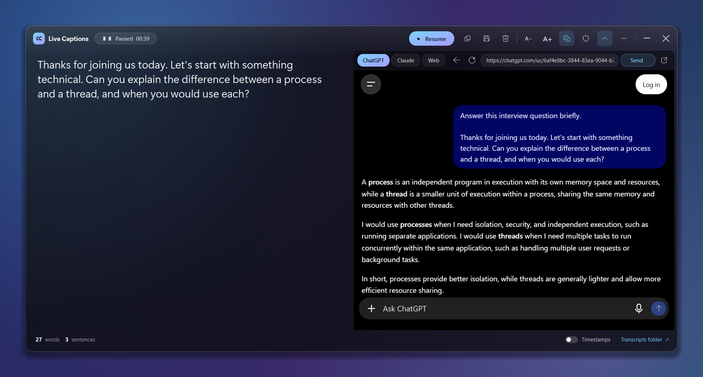
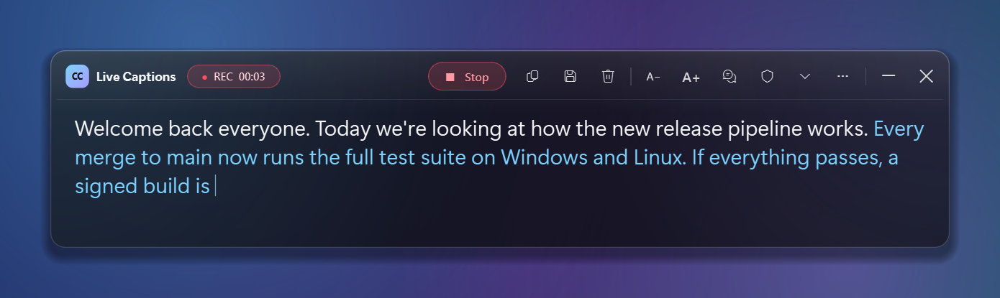
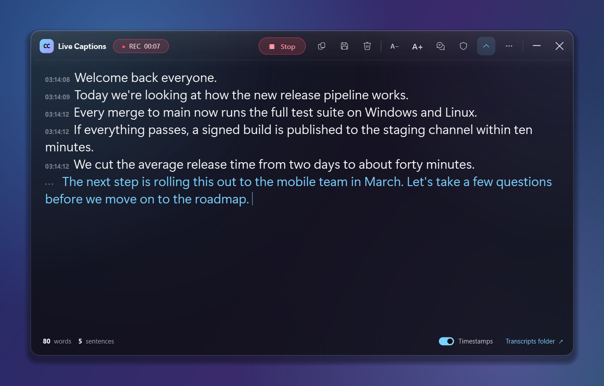

# Caption Assist

**Live captions on one half, ChatGPT or Claude on the other — invisible to screenshots and screen sharing.**

Caption Assist collects every sentence from Windows 11 Live Captions into a clean transcript and,
with one click (`Ctrl+B`), opens an AI side panel right next to it. Send what was just said to
ChatGPT or Claude (`Ctrl+Enter`) and read the answer while the captions keep rolling. With
private mode (on by default) none of the app's windows show up in screenshots, recordings or
screen sharing — only you can see them.

> Works with any audio playing on your PC: meetings (Teams, Meet, Zoom), lectures, YouTube,
> podcasts. Speech recognition runs **on-device** in Windows. Only what you choose to send in the AI
> panel goes to that website.

<p align="center">
  
  <br><sub>The AI side panel: the interviewer's question was captioned on the left, one click on <b>Send</b>
  passed it to ChatGPT with a short instruction, and the answer appeared on the right.</sub>
</p>

<p align="center">
  
</p>

<p align="center">
  
  <br><sub>Compact caption bar (top) and the expanded transcript with timestamps (bottom). White = saved
  sentences, blue = the sentence still being spoken.</sub>
</p>

## Features

- **AI side panel** — ChatGPT, Claude or any website in a split view beside the captions
  (`Ctrl+B`). Drag the divider to resize; you stay signed in between runs.
- **Send captions to the AI** — `Ctrl+Enter` or **Send captions** pastes everything said since
  the last send into the chat box (menu: last 5 sentences or the whole transcript).
- **Hidden from screen capture** — private mode (on by default) hides *every* window of the app —
  captions, AI panel, menus, tooltips, sign-in pop-ups — from screenshots, recordings and
  Teams / Zoom / Meet screen sharing.
- **Persistent transcript** — captions accumulate until you press Stop; no more lines vanishing.
- **Smart de-duplication** — handles Live Captions' rolling window, re-punctuation and revisions.
- **Keeps running when minimized** — Live Captions itself is parked off-screen so it never pauses.
- **Copy, save & export** — plain text, text with timestamps, Markdown or `.srt` subtitles.
- **Auto-save** — every session is written to `Documents\Caption Assist` as you go.
- **Frosted-glass UI** — compact caption bar or expanded transcript view, adjustable text size,
  always-on-top, draggable and resizable.
- **Real background blur** while private mode is on.
- **System tray**, single instance, crash logging, self-healing if Live Captions freezes.

## Requirements

- Windows 11 **22H2 or newer** (Live Captions is built in). Set it up once with **Win + Ctrl + L**
  and download a language when Windows asks.
- Python 3.10+ (only when running from source).
- Sign in to ChatGPT / Claude inside the panel with **email** — Google blocks "Continue with Google"
  in built-in browsers. ChatGPT also works without signing in.

## Install & run

### Option A — standalone app
Download `CaptionAssist-<version>-win64.zip` from the
[Releases](https://github.com/hassaankhalid225/caption-assist/releases) page, unzip, run
`CaptionAssist.exe`.

### Option B — from source
```powershell
git clone https://github.com/hassaankhalid225/caption-assist.git
cd caption-assist
python -m pip install -e .
caption-assist            # or: pythonw run.pyw   /   double-click "Start Caption Assist.bat"
```

Command-line options: `--start` (begin recording right away), `--ai` (open the AI panel),
`--debug` (verbose log), `--version`.

## Usage

| Action | How |
|---|---|
| Start / stop | **▶ Start** button or `Ctrl+R` |
| Copy everything | Copy icon or `Ctrl+Shift+C` (select text + `Ctrl+C` copies a part) |
| Save / export | Save icon or `Ctrl+S` → choose `.txt`, `.md` or `.srt` |
| Bigger / smaller text | `A+` / `A−` or `Ctrl+=` / `Ctrl+-` |
| Expand transcript | Chevron icon, `Ctrl+E` or double-click the title bar |
| AI side panel | Chat icon or `Ctrl+B`; switch ChatGPT / Claude / Web at the top of the panel |
| Send captions to the AI | **Send captions** or `Ctrl+Enter` (arrow for last 5 sentences / whole transcript) |
| Hide from screen sharing | Shield icon (on by default) |
| Settings | **⋯** menu: always on top, private mode, glass blur, timestamps, auto-save, transcripts folder |
| Quit | ✕ or `Ctrl+Q` (Live Captions is restored to normal) |

**Which audio is captioned?** Live Captions listens to your PC's *output* (what you hear).
Your microphone is only included if you enable *Include microphone audio* in Live Captions'
own settings.

## How it works

1. Live Captions renders its text in a XAML `TextBlock` (`CaptionsTextBlock`); the app reads it
   through **UI Automation** a few times per second.
2. Each snapshot goes through `Transcript`, which anchors new text against what's already been
   committed, keeps the unfinished sentence separate and ignores text that existed before you
   pressed Start.
3. Live Captions stops updating when minimized, so the app moves its window far off-screen and
   removes its taskbar button instead — and puts it back when you quit.
4. The AI panel is a Qt WebEngine (Chromium) browser with its own persistent profile in
   `%LOCALAPPDATA%\CaptionAssist\web`. **Send** types the captions into the page's chat box and
   presses its send button.
5. Private mode calls `SetWindowDisplayAffinity(WDA_EXCLUDEFROMCAPTURE)` on every window the app
   shows, so screenshots, recorders and screen sharing see whatever is behind it instead.

```
src/caption_assist/
├── core/          # platform-independent: text utils, Transcript, Recorder loop, AI send logic (unit-tested)
├── win/           # Win32 bindings + Live Captions controller (UI Automation)
├── ui/            # PySide6 glass window, AI side panel, widgets, tray, theme
├── config.py      # settings (QSettings) and paths
└── app.py         # entry point: logging, single instance, wiring
```

## Privacy

- Speech recognition is done by Windows on your device; the captions never leave your PC unless
  you press **Send**, which passes them to the site open in the AI panel (ChatGPT, Claude, …).
- Sign-ins for the AI panel are stored only in `%LOCALAPPDATA%\CaptionAssist\web`.
- Transcripts are saved only where you choose (default `Documents\Caption Assist`); turn
  auto-save off in the ⋯ menu.
- Logs (no transcript text) live in `%LOCALAPPDATA%\CaptionAssist\logs`.
- Please respect the people you record: follow your local laws and your organisation's policies,
  and ask for consent where required.

## Troubleshooting

| Problem | Fix |
|---|---|
| "Live Captions unavailable" | Needs Windows 11 22H2+. Press Win + Ctrl + L once and finish its setup. |
| Nothing appears | Make sure audio is actually playing and Live Captions' language matches the speech. |
| Live Captions window is still hidden after a crash | Start and quit the app once, or press Win + Ctrl + L twice. |
| Private mode has no effect | Requires Windows 10 version 2004 or newer. |
| "Continue with Google" fails in the AI panel | Google blocks sign-in from built-in browsers — use email sign-in. |
| Send only pastes, doesn't submit | Turn on *Press send automatically* in the arrow menu next to **Send**. |
| AI panel says Qt WebEngine is missing | `python -m pip install PySide6-WebEngine` |

## Development

```powershell
python -m pip install -e ".[dev]"
ruff check src tests
python -m pytest
powershell -ExecutionPolicy Bypass -File scripts\build.ps1   # builds dist\CaptionAssist
```

See [CONTRIBUTING.md](CONTRIBUTING.md). Releases are built automatically by GitHub Actions when a
`v*` tag is pushed.

## License

[MIT](LICENSE)

*Not affiliated with Microsoft. "Windows" and "Live Captions" are trademarks of Microsoft Corporation.*
